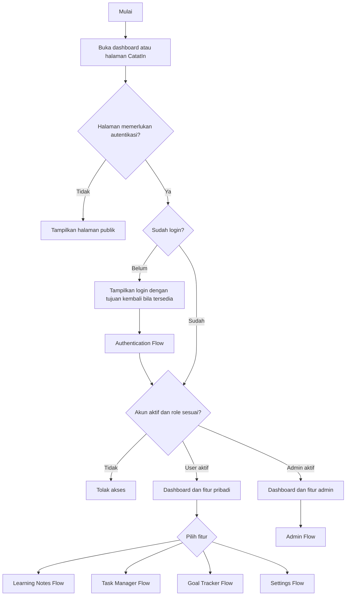
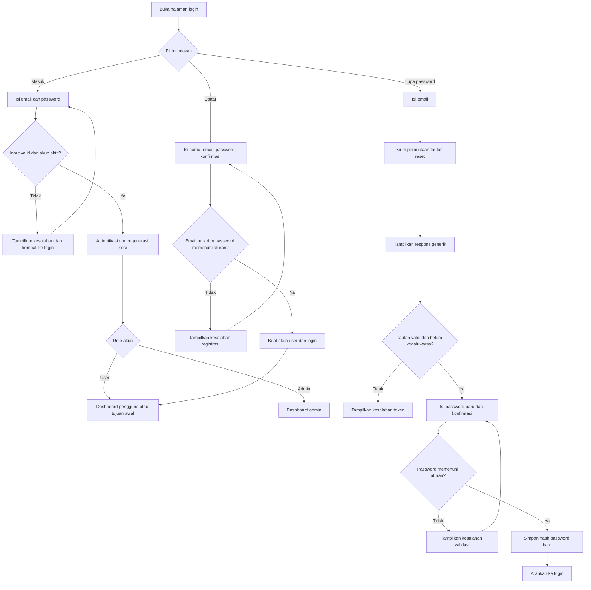
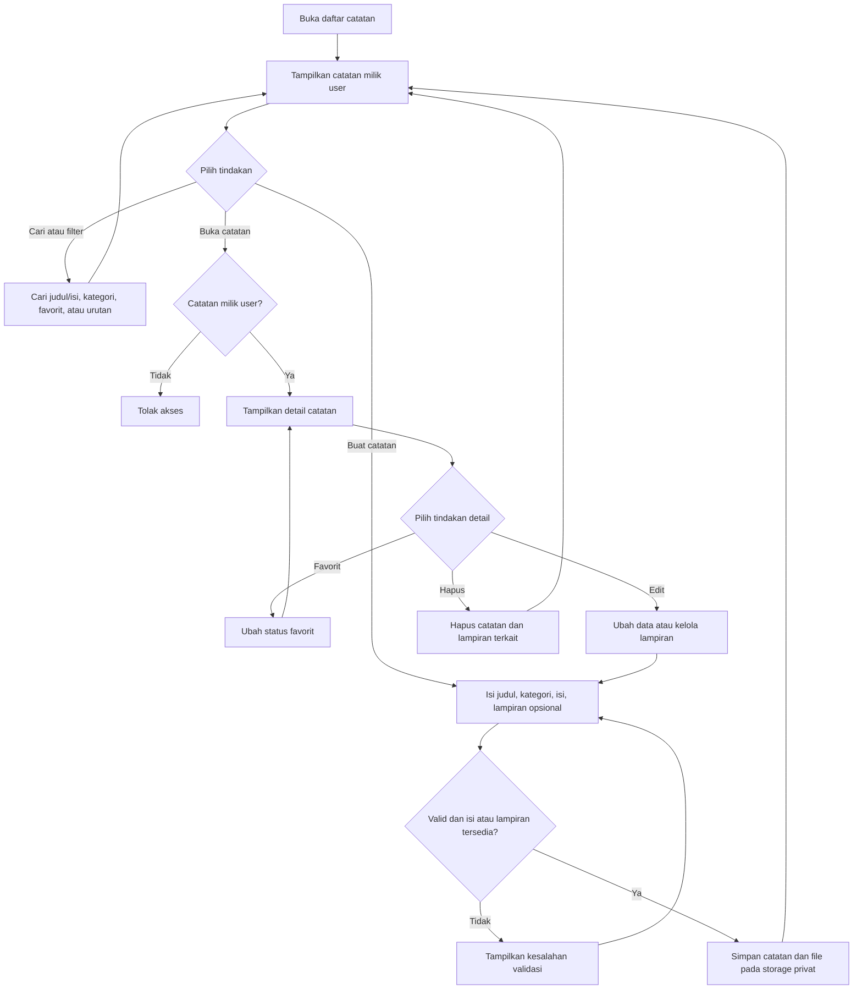
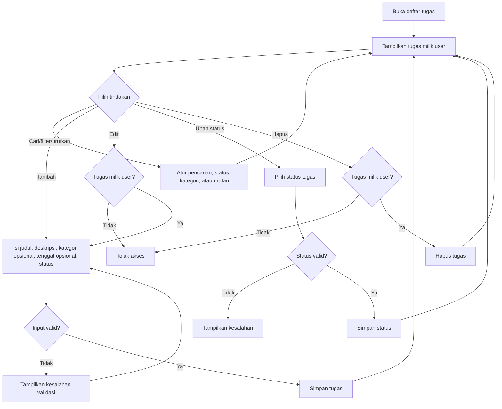
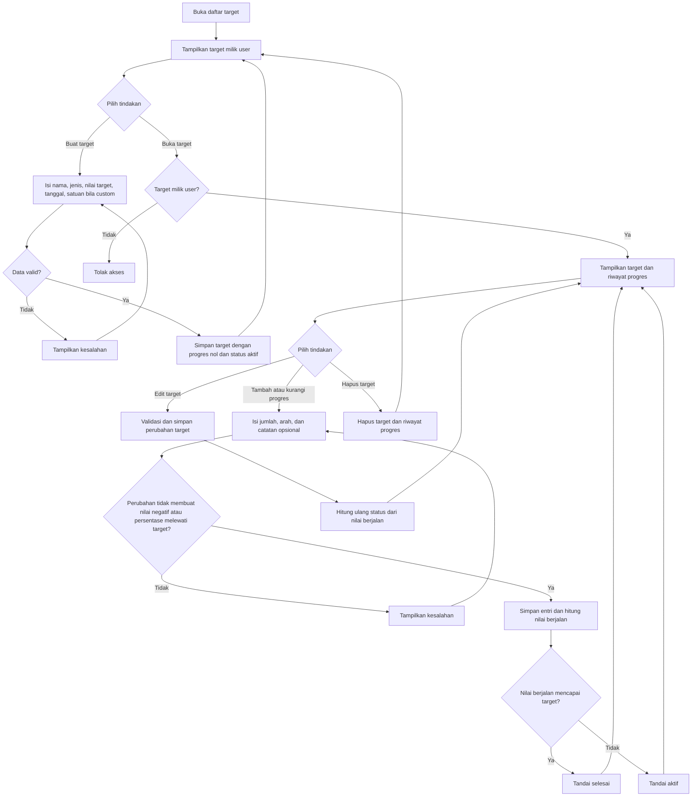
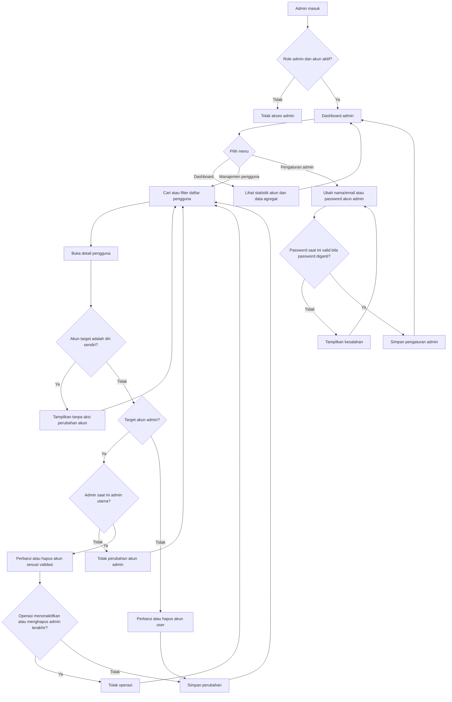
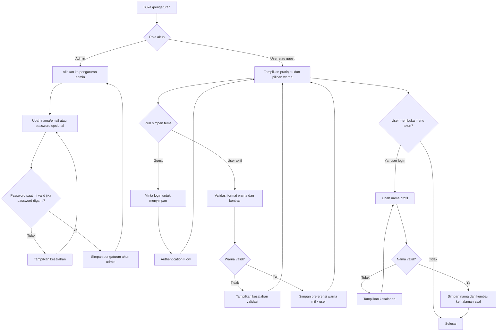

# Flowchart CatatIn

> Diagram berikut menggambarkan alur yang ditemukan pada source code dan dokumentasi aplikasi, bukan rancangan fitur masa depan.

## Daftar Isi

- [Main Application Flow](#main-application-flow)
- [Authentication Flow](#authentication-flow)
- [Learning Notes Flow](#learning-notes-flow)
- [Task Manager Flow](#task-manager-flow)
- [Goal Tracker Flow](#goal-tracker-flow)
- [Admin Flow](#admin-flow)
- [Settings Flow](#settings-flow)

## Main Application Flow

Alur umum dimulai dari dashboard yang dapat dibuka guest. Fitur produktivitas memerlukan user aktif, sedangkan area admin memerlukan admin aktif. Jika guest mencoba halaman privat dari navigasi, aplikasi mengarahkannya ke login.

**Keterangan proses:** dashboard `/` bersifat publik. Middleware `auth` dan role aktif membatasi halaman privat. Navigasi sidebar berbeda untuk pengguna dan admin.

## Authentication Flow

Pengguna dapat masuk, mendaftar, atau meminta reset password. Akun baru langsung login setelah berhasil dibuat. Login berhasil memerlukan akun aktif; reset password bergantung pada email yang dikonfigurasi.

**Keterangan proses:** password registrasi dan reset minimum 8 karakter, tanpa syarat kombinasi karakter tertentu; konfirmasi password tetap harus sama. Respons permintaan reset tidak mengungkap apakah email terdaftar. Login dan reset diberi pembatasan request.

## Learning Notes Flow

User aktif dapat mengelola catatan miliknya, mencari dan memfilter daftar, serta mengunggah lampiran yang memenuhi konfigurasi aplikasi.

**Keterangan proses:** kategori wajib dipilih dari data yang tersedia. Catatan harus memiliki isi atau minimal satu lampiran. Akses preview/download lampiran melalui route yang memeriksa pemilik catatan.

## Task Manager Flow

Task Manager menyediakan daftar, filter, CRUD, dan perubahan status tugas milik user aktif.

**Keterangan proses:** status yang diterima adalah pending, in progress, dan completed. Tenggat opsional; tugas belum tuntas bertenggat sebelum hari ini terhitung terlewat pada dashboard.

## Goal Tracker Flow

Goal Tracker mengelola target pribadi serta riwayat perubahan progres.

**Keterangan proses:** gambar target bersifat opsional dan privat. Perubahan progres dilakukan dalam transaksi agar nilai target dan entri riwayat tetap konsisten.

## Admin Flow

Admin aktif diarahkan ke area administrasi. Hak untuk mengelola akun admin dibatasi, dan admin terakhir dilindungi dari penghapusan atau penonaktifan.

**Keterangan proses:** admin tidak dapat mengubah atau menghapus dirinya melalui manajemen pengguna. Penggantian password admin memerlukan password saat ini. Perlindungan admin terakhir juga ditegakkan pada model.

## Settings Flow

Halaman pengaturan tampilan dapat dibuka guest, tetapi penyimpanan preferensi memerlukan user aktif. Admin diarahkan ke halaman pengaturan admin.

**Keterangan proses:** warna harus berupa hex `#RRGGBB` dan memenuhi rasio kontras minimum 4,5 terhadap putih. Pengguna biasa dapat mengubah nama, tetapi source tidak menyediakan penggantian email/password biasa dari halaman pengaturan ini.
