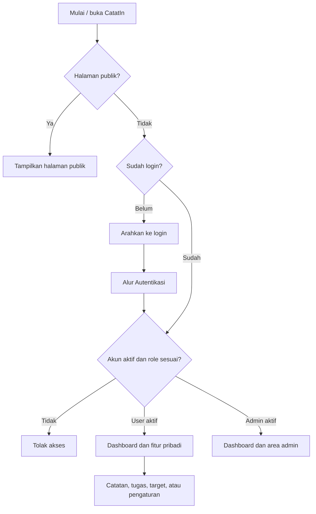
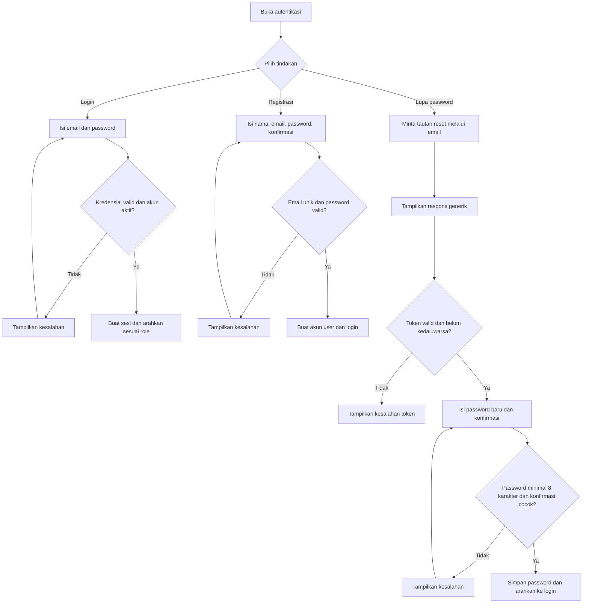
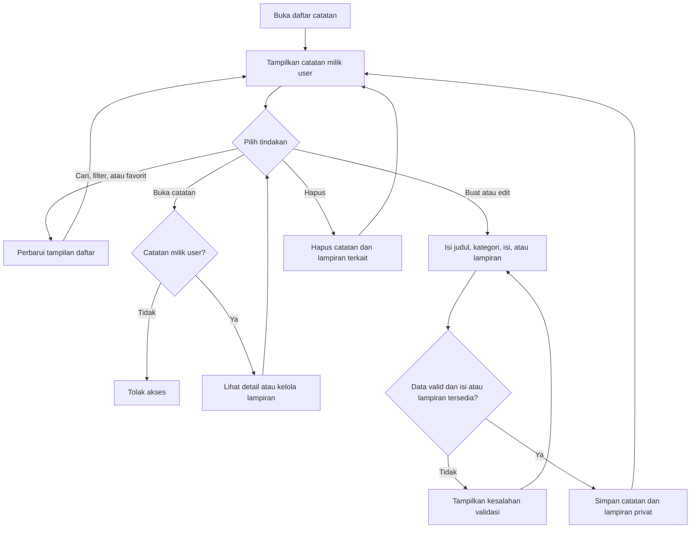
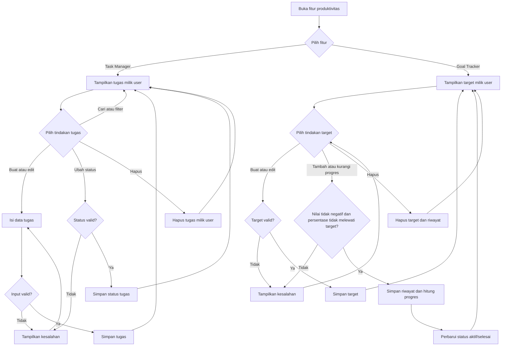
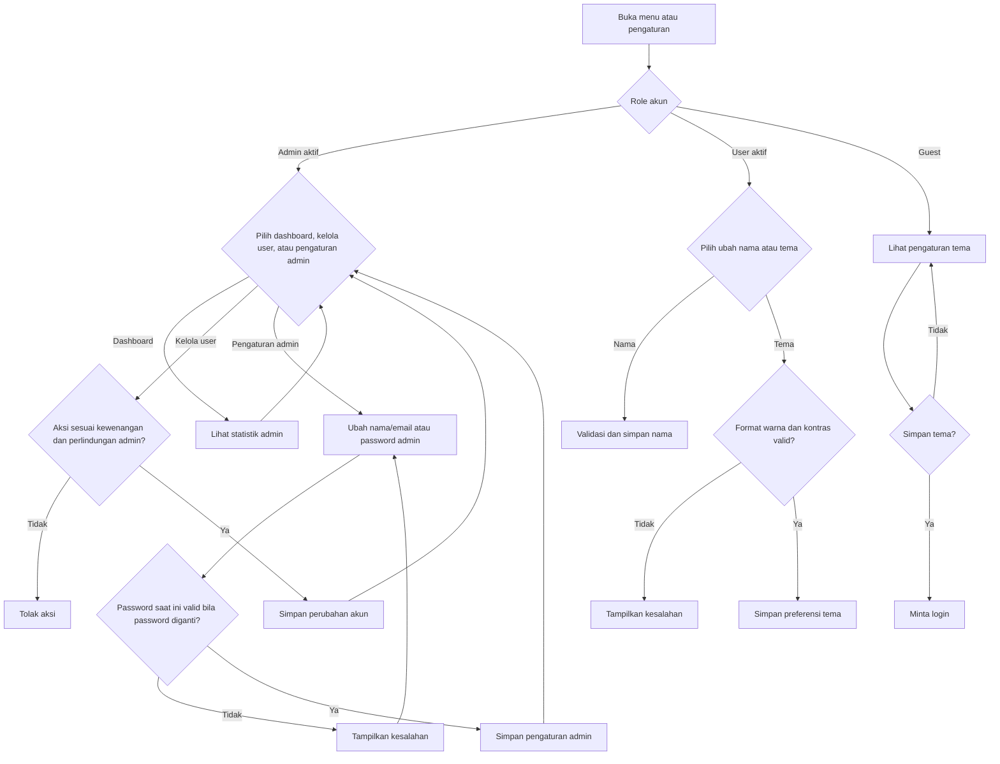

# PRD CatatIn

> **Status dokumen:** draf berdasarkan audit source code repository pada 10 November 2026. Dokumen ini menjelaskan implementasi yang ditemukan, bukan komitmen roadmap. Tujuan pengguna dan persona masih hipotesis karena belum ada hasil riset pengguna di repository.

## Daftar Isi

- [Product Overview](#product-overview)
- [Latar Belakang dan Tujuan](#latar-belakang-dan-tujuan)
- [Ruang Lingkup Produk](#ruang-lingkup-produk)
- [Target User dan User Persona](#target-user-dan-user-persona)
- [User Roles & Permissions](#user-roles--permissions)
- [Functional Requirements](#functional-requirements)
- [Feature Specifications](#feature-specifications)
- [Non-Functional Requirements](#non-functional-requirements)
- [Data Requirements](#data-requirements)
- [Constraints & Out of Scope](#constraints--out-of-scope)
- [Acceptance Criteria](#acceptance-criteria)
- [Flowchart Utama](#flowchart-utama)
  - [Alur Aplikasi](#alur-aplikasi)
  - [Alur Autentikasi](#alur-autentikasi)
  - [Alur Catatan Belajar](#alur-catatan-belajar)
  - [Alur Task Manager dan Goal Tracker](#alur-task-manager-dan-goal-tracker)
  - [Alur Admin dan Pengaturan](#alur-admin-dan-pengaturan)

## Product Overview

CatatIn adalah aplikasi web berbahasa Indonesia untuk mengelola catatan belajar dan kegiatan produktivitas pribadi. Pengguna yang masuk dapat mencatat materi, mengelola tugas dan target, serta mengatur tampilan akun. Aplikasi menyediakan dashboard ringkasan dan panel administrasi untuk akun dengan role admin.

Implementasi menggunakan Laravel 11, Blade, Tailwind CSS, dan database relasional MySQL/MariaDB.

## Latar Belakang dan Tujuan

### Latar belakang

Fitur dalam aplikasi menunjukkan kebutuhan untuk menyimpan catatan belajar, menjaga tugas dan tenggat tetap terpantau, serta mencatat progres target dari satu ruang pribadi. Pernyataan masalah ini disimpulkan dari implementasi; belum diverifikasi melalui riset pengguna.

### Tujuan produk

1. Menyediakan tempat terpusat untuk membuat, mencari, dan mengelola catatan belajar.
2. Membantu pengguna mengelola tugas pribadi beserta status dan tenggatnya.
3. Membantu pengguna menetapkan target dan melihat perubahan progresnya.
4. Menampilkan ringkasan tugas dan target yang relevan pada dashboard.
5. Memisahkan akses pengguna biasa dan admin serta membatasi akses terhadap data pribadi.

Belum ditemukan baseline analitik atau sasaran kuantitatif produk yang terkonfirmasi. Metrik keberhasilan perlu disepakati bersama pemilik produk sebelum dipakai untuk evaluasi.

## Ruang Lingkup Produk

### Termasuk

- Registrasi, login, logout, dan pemulihan password.
- Dashboard produktivitas.
- Catatan belajar, kategori, favorit, dan lampiran privat.
- Task Manager dengan kategori, status, dan tenggat.
- Goal Tracker dengan jenis target, nilai progres, dan riwayat progres.
- Pengaturan nama dan preferensi warna tampilan untuk pengguna.
- Dashboard admin, manajemen akun, dan pengaturan admin.

### Batas peran produk

- Aplikasi ditujukan untuk ruang kerja pribadi per akun; kolaborasi antarakun tidak tersedia.
- Sebagian halaman publik dapat dilihat tanpa login, tetapi fitur produktivitas memerlukan akun aktif dengan role pengguna.
- Panel administrasi hanya untuk akun aktif dengan role admin.

## Target User dan User Persona

Persona berikut adalah hipotesis berdasarkan fitur yang tersedia dan perlu divalidasi dengan pengguna.

### Pelajar atau pembelajar mandiri

- Menyimpan catatan dan lampiran materi.
- Mengelompokkan catatan berdasarkan kategori.
- Mencari kembali catatan dan menggunakan favorit untuk akses cepat.

### Individu yang mengelola tugas dan target pribadi

- Membuat daftar pekerjaan dengan status dan tenggat.
- Memantau hal yang akan jatuh tempo atau sudah terlewat.
- Menetapkan target bernilai tertentu dan memperbarui progresnya.

### Admin aplikasi

- Memantau statistik akun dan penggunaan data secara agregat.
- Mencari, melihat, memperbarui status atau role pengguna sesuai kewenangan, dan menghapus akun.
- Mengatur informasi akun admin sendiri.

## User Roles & Permissions

| Peran | Hak akses yang terkonfirmasi |
|---|---|
| Guest | Melihat dashboard publik, halaman autentikasi, dan halaman pengaturan tampilan. Tidak dapat mengakses route fitur produktivitas; aksi simpan yang memerlukan akun meminta login. |
| User aktif | Mengakses dashboard pribadi, catatan dan lampirannya, tugas, target dan riwayat progres, kategori, pengaturan nama, serta preferensi tampilan miliknya. |
| Admin aktif | Mengakses panel admin, daftar dan detail pengguna, aksi manajemen yang diizinkan, dan pengaturan akun admin. Route produktivitas yang memakai middleware role user tidak termasuk akses admin. |
| Akun nonaktif | Ditolak oleh middleware pada route yang memerlukan role user atau admin aktif. Login juga mensyaratkan akun aktif. |

### Pembatasan administrasi

- Akun tidak dapat mengubah atau menghapus dirinya melalui halaman manajemen pengguna.
- Admin biasa tidak dapat mengelola akun admin; perubahan akun admin hanya diizinkan untuk admin utama yang dikonfigurasi.
- Admin aktif terakhir tidak dapat dinonaktifkan atau diturunkan rolenya; akun admin terakhir tidak dapat dihapus.
- Admin dapat mengatur nama, email, dan password miliknya melalui halaman pengaturan admin. Penggantian password mensyaratkan password saat ini.

## Functional Requirements

Prioritas: **P0** = alur inti; **P1** = kemampuan pendukung; **P2** = administrasi.

| ID | Prioritas | Persyaratan fungsional |
|---|---|---|
| FR-01 | P0 | Sistem menyediakan registrasi, login, logout, opsi ingat akun, dan pemulihan password melalui email. |
| FR-02 | P0 | Sistem memisahkan resource pribadi berdasarkan pemilik dan menolak akses yang tidak berwenang. |
| FR-03 | P0 | Dashboard menyajikan jumlah tugas per status, target aktif, tugas mendatang tujuh hari, serta tugas terlewat untuk akun aktif. |
| FR-04 | P0 | Pengguna dapat membuat, membaca, memperbarui, menghapus, mencari, memfilter, mengurutkan, dan memfavoritkan catatan miliknya. |
| FR-05 | P1 | Pengguna dapat mengelola lampiran catatan melalui penyimpanan privat dan route yang memeriksa akses. |
| FR-06 | P0 | Pengguna dapat membuat dan mengelola tugas, mencari dan memfilter daftar, mengatur tenggat opsional, serta mengubah status tugas miliknya. |
| FR-07 | P0 | Pengguna dapat membuat dan mengelola target serta menambah atau mengurangi progres melalui entri riwayat. |
| FR-08 | P1 | Pengguna dapat membuat dan mengelola kategori yang digunakan oleh data belajar dan tugas. Kategori yang sedang dipakai tidak dapat dihapus. |
| FR-09 | P1 | Pengguna dapat mengubah nama profil dan preferensi warna tampilan akun sendiri. |
| FR-10 | P2 | Admin aktif dapat melihat statistik admin dan mengelola akun pengguna sesuai pembatasan role. |
| FR-11 | P2 | Admin dapat memperbarui nama, email, dan password akunnya sendiri melalui pengaturan admin. |

## Feature Specifications

### Autentikasi dan akun

- Route utama: `/login`, `POST /login`, `POST /register`, `/forgot-password`, `/reset-password/{token}`, `POST /logout`.
- Registrasi meminta nama, email unik, password, dan konfirmasi password.
- Password registrasi dan reset minimal 8 karakter; tidak ada syarat komposisi huruf besar/kecil, angka, atau simbol. Konfirmasi password harus sama.
- Pengguna baru masuk setelah registrasi berhasil; akun umum menggunakan role `user`.
- Login hanya berhasil untuk kredensial yang benar dan akun aktif. Sesi diregenerasi setelah autentikasi.
- Permintaan reset menggunakan respons generik untuk tidak mengungkap apakah email terdaftar. Tautan reset bergantung pada konfigurasi email.
- Form login dan reset serta operasi autentikasi menerapkan validasi dan pembatasan request pada route terkait.

### Dashboard

- Route: `/` dan `/dashboard`.
- Guest dapat melihat dashboard tanpa data akun pribadi.
- Pengguna biasa melihat ringkasan tugas dan target miliknya.
- Tugas mendatang adalah tugas belum tuntas dengan tenggat hari ini sampai tujuh hari ke depan; tampilan dashboard membatasi daftar yang ditampilkan.
- Tugas terlewat adalah tugas belum tuntas dengan tenggat sebelum hari ini.
- Admin diarahkan ke dashboard admin.

### Catatan belajar

- Route: `/catatan`, `/catatan/create`, `POST /catatan`, `/catatan/{id}`, `/catatan/{id}/edit`, `PUT /catatan/{id}`, `DELETE /catatan/{id}`, `PATCH /catatan/{id}/favorit`.
- Pengguna dapat mencari berdasarkan judul/isi, memfilter kategori/favorit, mengurutkan, dan melihat halaman khusus favorit.
- Judul wajib, maksimum 150 karakter; kategori wajib dipilih dari kategori yang ada.
- Isi boleh kosong jika ada setidaknya satu lampiran; jika tanpa lampiran, isi harus tersedia.
- Batas jumlah, ukuran, ekstensi, dan MIME lampiran mengikuti `config/learning.php`; validasi juga dilakukan sebelum file disimpan.
- Lampiran disimpan pada disk privat. Pratinjau, unduh, dan hapus menggunakan route aplikasi.
- Akses catatan dibatasi pada `user_id` akun yang sedang login.

### Kategori

- Route: `/kategori`, `/kategori/tambah`, `POST /kategori`, `/kategori/{category}/edit`, `PUT /kategori/{category}`, `DELETE /kategori/{category}`.
- Nama kategori wajib, maksimum 100 karakter, dirapikan spasinya, dan tidak boleh duplikat tanpa membedakan kapitalisasi.
- Kategori tidak memiliki `user_id` pada skema yang diaudit sehingga dikelola sebagai data bersama.
- Kategori yang masih digunakan catatan, tugas, atau relasi kategori yang ada tidak dapat dihapus.
- Perubahan nama kategori memperbarui nilai kategori legacy pada catatan dalam transaksi.

### Task Manager

- Route: `/tugas`, `/tugas/tambah`, `POST /tugas`, `/tugas/{task}/edit`, `PUT /tugas/{task}`, `PATCH /tugas/{task}/status`, `DELETE /tugas/{task}`.
- Judul wajib, maksimum 100 karakter, dan mengikuti aturan judul alfanumerik aplikasi.
- Deskripsi opsional maksimum 5.000 karakter; kategori dan tenggat opsional.
- Status hanya `pending`, `in_progress`, atau `completed`.
- Daftar mendukung pencarian, filter status/kategori, pagination, urutan tenggat atau waktu dibuat.
- Perubahan dan penghapusan hanya diizinkan untuk pemilik tugas.

### Goal Tracker

- Route: `/target`, `/target/buat`, `POST /target`, `/target/{goal}`, `/target/{goal}/edit`, `PUT /target/{goal}`, `POST /target/{goal}/progres`, `DELETE /target/{goal}`.
- Jenis target yang disimpan meliputi custom, money, dan percentage; nilai yang diterima untuk jenis yang dikirim mencakup money dan percentage, sementara jenis yang tidak dikirim menggunakan custom.
- Nama wajib, maksimum 100 karakter. Nilai target harus positif; tanggal mulai wajib dan tenggat opsional tidak boleh sebelum tanggal mulai.
- Target baru dimulai dengan nilai progres nol dan status aktif.
- Satuan untuk uang dan persentase ditetapkan sistem; target custom memerlukan satuan.
- Entri progres memiliki jumlah positif, catatan opsional maksimum 500 karakter, serta arah tambah atau kurang.
- Pengurangan tidak boleh membuat nilai di bawah nol. Progres persentase tidak boleh melebihi target.
- Status menjadi selesai saat nilai berjalan mencapai target dan aktif kembali bila nilainya berada di bawah target.
- Gambar opsional menerima JPG/JPEG/PNG/WebP hingga 5 MB dan dimensi maksimum 4096 x 4096; file disimpan privat.
- Target dan riwayat progres hanya dapat diakses pemiliknya; penghapusan target menghapus riwayat terkait.

### Pengaturan pengguna

- Route: `GET /pengaturan`, `PUT /pengaturan/profil`, `POST /pengaturan/tampilan`.
- Pengguna dapat mengubah nama dari menu akun; tidak ditemukan alur pengguna biasa untuk mengganti email atau password pada halaman pengaturan tersebut.
- Pengguna login dapat menyimpan warna aksen dan warna navigasi/footer dalam format hex `#RRGGBB`.
- Warna harus memenuhi rasio kontras minimum 4,5 terhadap putih.
- Guest dapat melihat halaman pengaturan, tetapi menyimpan preferensi memerlukan autentikasi.
- Admin yang membuka `/pengaturan` dialihkan ke halaman pengaturan admin.

### Panel admin

- Route: `/admin/dashboard`, `/admin/users`, `/admin/users/{user}`, `PUT /admin/users/{user}`, `DELETE /admin/users/{user}`, `/admin/settings`.
- Dashboard admin menampilkan jumlah pengguna, pengguna aktif, jumlah role, pendaftaran enam bulan terakhir, serta agregat catatan, tugas, dan target.
- Daftar pengguna mendukung pencarian nama/email, filter role/status, pagination, dan detail akun.
- Admin yang berwenang dapat mengubah nama, email, role, dan status pengguna serta menghapus akun.
- Penghapusan akun menghapus data terkait sesuai relasi cascade yang didefinisikan.
- Batasan admin utama dan perlindungan admin terakhir harus tetap berlaku.

## Non-Functional Requirements

### Keamanan dan privasi

- Route privat dilindungi autentikasi dan middleware role/status yang sesuai.
- Query dan operasi resource memeriksa kepemilikan data; UI bukan satu-satunya lapisan kontrol akses.
- Password disimpan sebagai hash. Logout mengakhiri dan menginvalidasi sesi serta memperbarui token CSRF.
- Lampiran catatan dan gambar target disimpan pada disk privat dan hanya disajikan setelah pemeriksaan pemilik.
- Secret, kredensial email, dan konfigurasi deployment tidak boleh disimpan di repository.

### Ketersediaan dan ketergantungan

- Aplikasi memerlukan runtime Laravel dan database yang dikonfigurasi.
- Reset password melalui email memerlukan SMTP yang dapat mengirim di environment tujuan.
- Deployment memerlukan storage privat yang persisten untuk file pengguna.
- Tidak ada SLA, target performa, atau target ketersediaan yang dapat dipastikan dari source.

### Usability dan aksesibilitas

- Bahasa antarmuka utama adalah Bahasa Indonesia.
- Form memvalidasi input pada server dan menampilkan kesalahan yang relevan.
- Navigasi mendukung layout desktop dan mobile pada template aplikasi.
- Rasio kontras warna tema divalidasi untuk keterbacaan teks.

## Data Requirements

### Entitas dan relasi utama

| Entitas | Data utama | Relasi/kepemilikan terkonfirmasi |
|---|---|---|
| `users` | Nama, email unik, password hash, role, status aktif, atribut autentikasi | Pemilik catatan, tugas, target, progres, dan preferensi tema. |
| `catatan` | Judul, isi, kategori legacy, `category_id`, favorit, `user_id` | Dimiliki pengguna; berelasi dengan kategori dan memiliki banyak lampiran. Kolom `user_id` nullable pada migrasi untuk kompatibilitas data lama, tetapi query aplikasi membatasi ke pemilik yang login. |
| `catatan_attachments` | Nama asli, extension, MIME, ukuran, disk, path | Anak catatan; penghapusan catatan menghapus relasi lampiran. File berada pada disk privat. |
| `categories` | Nama unik | Tidak memiliki `user_id`; kategori merupakan data bersama dan digunakan catatan/tugas serta relasi kategori lain. |
| `tasks` | Judul, deskripsi, tenggat opsional, status, `user_id`, `category_id` opsional | Dimiliki pengguna; berelasi ke satu kategori bila dipilih. |
| `goals` | Nama, jenis, deskripsi, nilai target/nilai berjalan, langkah progres, satuan, tanggal, status, path gambar, `user_id` | Dimiliki pengguna dan memiliki banyak entri progres. |
| `goal_progress_entries` | Goal, user, jumlah bertanda, catatan opsional, waktu tercatat | Berelasi ke pasangan target/pemilik; foreign key gabungan menjaga kepemilikan konsisten. |
| `user_preferences` | Warna aksen dan warna navigasi/footer | Satu preferensi tema per pengguna. |

### Validasi dan retensi data

- Batas karakter, nilai numerik, tanggal, format file, dan enum mengikuti validasi yang dijelaskan per fitur.
- Data privat harus menggunakan filter pemilik pada setiap pembacaan/perubahan yang relevan.
- Kebijakan retensi, ekspor data, serta penghapusan akun dari sudut pandang operasional perlu dikonfirmasi; source tidak menetapkan kebijakan retensi umum.

## Constraints & Out of Scope

### Constraints

- Source yang diaudit adalah aplikasi web Laravel, bukan aplikasi mobile native.
- Database, SMTP, dan storage privat perlu disediakan/dikonfigurasi untuk environment deployment.
- Kategori tersedia bersama dan tidak memiliki kepemilikan per user pada skema yang diaudit.
- Tidak ada bukti di repository tentang baseline metrik, SLA, atau hasil riset persona.
- Dokumentasi ini hanya mencakup alur yang tersedia pada source code yang diaudit.

### Out of scope atau belum tersedia

- Kolaborasi, berbagi catatan, assignment tugas, dan target bersama.
- Pengingat otomatis berbasis tenggat.
- Analisis otomatis konten video yang ditautkan.
- Alur transkripsi audio/video baru; dokumentasi aplikasi menyatakan fitur tersebut nonaktif.
- Penggantian email/password pengguna biasa pada pengaturan profil yang tersedia.
- Target kuantitatif produk sebelum disepakati bersama pemilik produk.

## Acceptance Criteria

1. **Autentikasi:** akun dapat mendaftar dengan email unik dan password minimal 8 karakter dengan komposisi bebas; login ditolak untuk kredensial salah atau akun nonaktif; logout mengakhiri sesi.
2. **Pemulihan password:** permintaan memberikan respons yang tidak membocorkan keberadaan email; token valid menerima password minimal 8 karakter dengan komposisi bebas; token invalid/kedaluwarsa ditolak.
3. **Isolasi data:** pengguna tidak dapat melihat, mengubah, menghapus, atau mengunduh catatan, lampiran, tugas, target, atau progres milik pengguna lain.
4. **Dashboard:** hitungan tugas per status, target aktif, tugas mendatang tujuh hari, dan tugas terlewat menggunakan data akun aktif saja.
5. **Catatan:** operasi CRUD, pencarian/filter/favorit, dan pengelolaan lampiran berhasil; isi atau setidaknya satu lampiran wajib tersedia; file privat tidak bisa diakses tanpa otorisasi.
6. **Kategori:** nama duplikat ditolak tanpa membedakan kapitalisasi; kategori yang masih digunakan oleh data terkait tidak dapat dihapus.
7. **Tugas:** hanya status yang diizinkan diterima; pencarian/filter/sort berfungsi; tenggat kosong diperbolehkan; operasi hanya berlaku untuk pemilik.
8. **Target:** target baru mulai pada progres nol; penambahan/pengurangan progres memperbarui nilai, riwayat, dan status; progres negatif atau persentase di atas target ditolak.
9. **Pengaturan:** perubahan nama dan tema hanya tersimpan untuk akun pemilik; warna tema yang tidak valid atau tidak memenuhi kontras ditolak; guest tidak dapat menyimpan tema.
10. **Admin:** route admin menolak guest/user/nonaktif; pembatasan admin utama dan admin terakhir tetap ditegakkan; admin tidak dapat menghapus atau mengubah dirinya lewat manajemen pengguna.
11. **Scope dokumentasi:** seluruh persyaratan dan diagram di dokumen ini sesuai dengan fitur yang tercantum dalam PRD dan implementasi yang diaudit.

## Flowchart Utama

Diagram ringkas berikut melengkapi persyaratan dan spesifikasi produk di dokumen ini. Alur menggambarkan fitur yang ditemukan pada source code, bukan rancangan fitur masa depan.

### Alur Aplikasi

Dashboard dapat dibuka publik. Fitur produktivitas memerlukan user aktif, sedangkan pengelolaan aplikasi memerlukan admin aktif.

### Alur Autentikasi

Pengguna dapat login, mendaftar, atau mengatur ulang password. Registrasi dan reset menerima password minimal delapan karakter tanpa syarat komposisi.

### Alur Catatan Belajar

Catatan dan lampirannya dikelola oleh user pemilik; pencarian, filter, favorit, dan lampiran privat tersedia.

### Alur Task Manager dan Goal Tracker

Tugas dan target dibatasi pada pemiliknya. Progres target dicatat dalam riwayat dan menentukan status aktif atau selesai.

### Alur Admin dan Pengaturan

Admin aktif mengelola akun sesuai pembatasan role. User dapat mengatur nama dan tema; guest hanya dapat melihat pengaturan tema.

